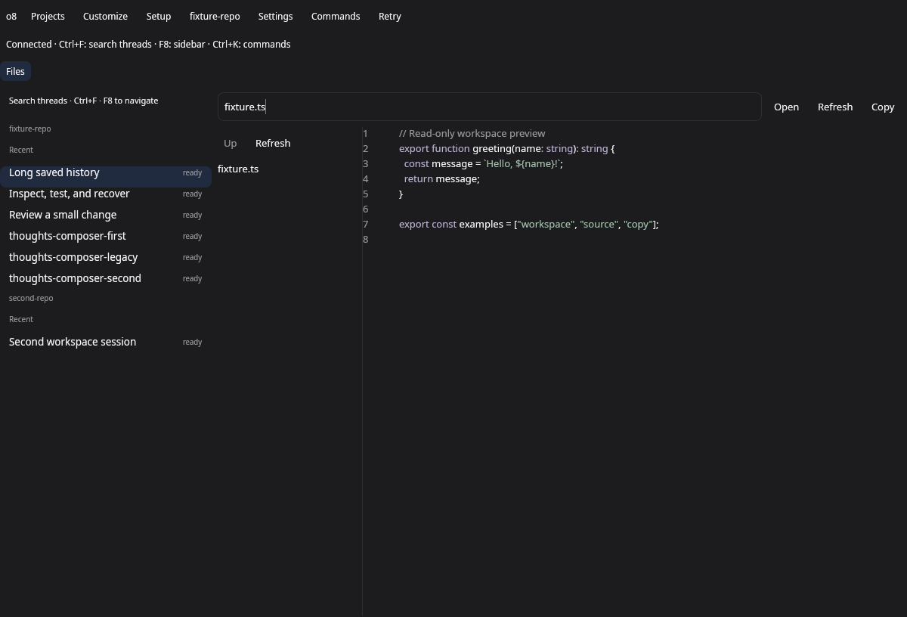
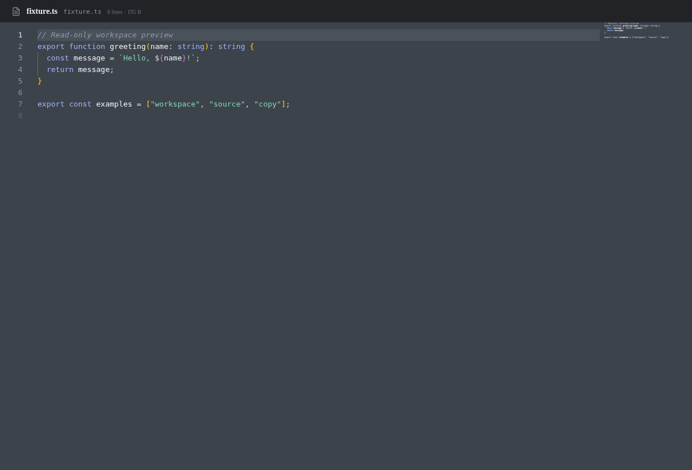

# Read-only file viewer

The opt-in Files surface registers through one line in `src/shell.rs`. Its view,
GET requests, source model, privacy guard and tests live in `src/surfaces/files/`.
The installed app and the commit-viewer branch are unchanged.

## Reading and browsing

Browse the workspace directory list, use Up to return to its parent, or enter a
relative path and Open. Refresh rereads the loaded path. File selection uses the
returned path, rather than the displayed name. Directory failures can be retried
with Refresh; file failures expose Retry. Empty files remain distinct from errors.

Source is virtualized GPUI `StyledText`, with line numbers and syntax coloring
using the existing TypeScript/TSX, JavaScript/JSX, Rust, JSON and Markdown grammars.
Other formats use plain source. Colors resolve from the shared theme tokens.
Copy and source-focused Ctrl+C/Cmd+C copy complete, unmasked text. Masked, binary
and truncated snapshots cannot be copied. The path field retains ordinary text
input; file content has no input entity, typing, paste, editing, Save or save key
handler. There is no surface write request or dirty-draft lifecycle.

## Read limits and privacy

Reads use the existing operator-authenticated `/api/panel/file-content` route with
`preview=1`; browsing uses `/api/panel/files`. Native previews refuse files above
32 MiB before decoding. The descriptor is canonicalized and validated by the
existing workspace-file boundary; a bounded stream also detects growth after
the size check. Reads at or below the limit retain raw-byte hashes and binary
metadata. Desktop requests without the preview flag retain their existing read
behavior. No write-route changes from the closed editing attempt remain.

Preview text is capped at 100,000 characters and each painted line at 2,048
characters plus an ellipsis. Parsing and masking happen off the UI thread.
Only the resulting safe model crosses into the view. A file containing a value
flagged by the guard renders `[masked]`; the entire source is masked and Copy is
disabled. There is no second editable or clipboard representation of that source.

The inherited guard covers labeled credential values, common credential URLs,
commands and serialized configuration. Computed environment keys are inspected
structurally, including concatenation, templates, member/index notation,
parentheses, comments and escaped names. Unresolved computed environment access
and excessive AST/string nesting fail closed. The inherited 128 secret cells
and 29 ordinary-reference controls remain covered. This format-based guard is
not a universal classifier for arbitrary unlabelled or dynamically encoded data.

The future save split still needs to guard every incoming edit, paste and IME
change before rendering, copying or saving, and retain stale-write refusals.
This PR removes those mutation paths rather than claiming their safety is solved.

## Visual evidence

These are real fixture captures, not a recreated native view. Native uses a
private Linux X11 display and software Vulkan. Current uses the production React
FileViewer and bundled Monaco in headless Chromium. Both render the same owned
TypeScript source at 1200 × 816, with no accounts or operator-machine access.

| Native GPUI shell | Current desktop FileViewer component |
| --- | --- |
|  |  |

Reproduce with an available Xvfb, xdotool, ImageMagick, Vulkan driver and Chromium:

```sh
node native/o8-next/src/surfaces/files/capture.mjs --binary <built-o8-next> --output native/o8-next/docs/surfaces/files/read-only
```

`capture.json` records the renderer boundaries and verifies that fixture requests
contained no mutation. `verify-module.mjs` compiles only this surface and its
registration against main, then checks that a file-save request method is absent.
The real-shell tests cover browsing, Open, Copy, Refresh, parent navigation,
read refusals, empty/binary/large files, secret masking and source input refusal.
See [red/green tails and measurements](files/read-only/verification.md) for the
checks and the five native-suite failures reproduced on clean main.
