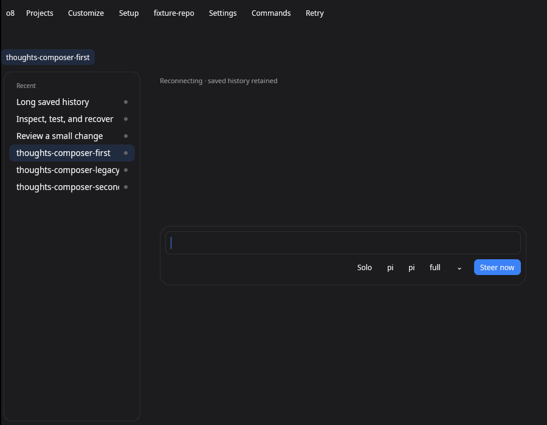
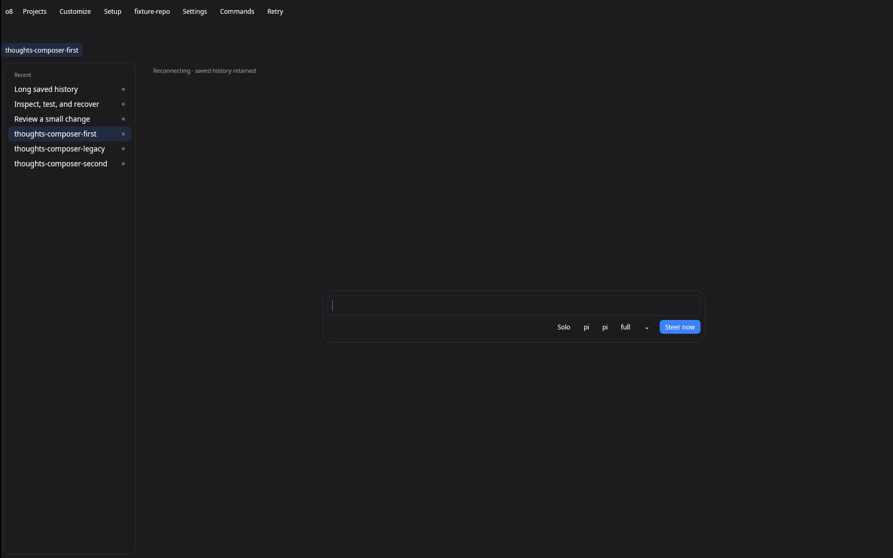

# Placement correction round 1

The empty conversation centres its composer card in the available column. No
build tagline, permanent shortcut line or mode-description helper remains. Saved
messages keep the composer below the transcript. The single shell header,
workspace switcher, palette Refresh and retained session Brain are preserved.

## Rebase and publication state

The first verification ran on main 0eeb65889, with placement replayed over the
reviewed chrome changes from #4716. One push published 0631d3ecd. The remote main
advanced during that push to 73d71ce89, introducing shell extension changes and
the Linux frame verifier. That published head conflicts with the newer main.

This local correction is rebased onto 73d71ce89 and resolves those conflicts
while preserving the new prepare/frame/allow-command extension hooks. A further
real-entry test failed when frame defaults restored alpha and shortcut labels;
the default frame now retains the concise chrome labels. The first three review
regressions had already failed before their fixes (red.txt). The rebase regression
has its own retained red and green tails.

Publishing this newer local head needs approval for a second push because the
requested single push was already used. No further push has been performed.

The ui.rs resolution keeps the embedded-header guard and shared geometry.
conversation.rs keeps Send next / Steer now as action labels and applies card/chip
tokens. Shell look tests live in their own test module so #4719's material tests
can merge without a same-location insertion conflict. The documentation keeps
its glass insertion anchor. No material implementation is copied here. This is
shell work because navigation, retained focus and shared frame geometry cross
the shell/session boundary. No screen is added.

## Verification

Review regressions in surface_tests.rs and shell_look_tests.rs:
- Empty conversation tagline: failed before, passed after at compact/wide sizes.
- Composer shortcut and mode helper: failed before, passed after.
- Duplicate embedded header / Refresh / Brain: failed before, passed after; palette
  Brain still opens the retained right slot.
- Rebased frame labels: failed before the default-frame correction, passed after.

At compact size with the right slot open, the composer changed from 333 × 175.5
at y=503.5 to 333 × 98 centred in its available column. At wide size it changed
from 720 × 118 to 720 × 98. The parent directory retains the original layout;
layout.json retains the corrected layout. Layout receipts are not screenshots.

Hostile-review risks and coverage:
1. Compact macOS geometry clips the composer or right slot: real fixture-backed
   layout asserts centre alignment, capped width and bounds at 900 × 700 and
   1680 × 1050.
2. Focus/resize selects a different retained entity: keyboard/input tests cover
   palette Brain, right-slot resize/close, workspace restore and main composer.
3. A send response races selecting an empty conversation: the real durable queue
   receives the original session's prompt; the newly selected conversation and
   draft remain empty.

Final checks: shell 10 passed / 1 explicitly ignored native display probe;
session/worker 8 passed; Brain 3 passed; palette 11 passed; theme 3 passed;
editor 4 passed. Total: 39 focused native tests passed. Four JavaScript real-path
suites passed 22 tests. Full npm test passed 1243 files / 9081 tests (3 files /
5 tests skipped). Typecheck:fast, full tsc with an 8192 MiB heap, touched-file
ESLint, rule-check and formatting passed. ESLint has no Rust/Python rules.
Classification passed: 1239 hermetic and 916 resource-owning tests.

The latest palette owns workspace entries and keyboard handling. Rebase tests
caught shell-only command identities incorrectly reaching surface registration
and the former shared-shell workspace ownership. Both reds are retained. Manual
Refresh/shortcut commands have explicit identities; workspace switching stays
inside the palette module. The workspace-only switcher uses that renderer and
scroll handle. The global Ctrl+Shift+P / Cmd+Shift+P entry is used from editors;
Ctrl+K / Cmd+K retains the focused editor's behavior as current main requires.

## Rendered screenshots and sixty-second CPU comparison

The initial black captures did not paint and understated process CPU. The final
protocol uses the expose event from scripts/next/linux-headless.mjs: xrefresh on
an owned virtual display, then captures that display's root. Only the fixture
app occupies each display. Four requested plain/glass and compact/wide cases run
against the real native CLI and existing --composer-empty route fixture.




The PNGs were inspected for readable text and fixture-only content. Baseline
PNGs are also retained. They show the reported tagline, shortcut line and extra
header/controls. The final captures have 660 baseline / 680 corrected colors.
The Linux renderer is plain dark; native macOS All Glass is supplied separately
by #4719. Appearance requests here do not prove macOS material rendering.

Each interval exceeds 60 seconds after startup and initial paint. /proc measures
native process user+system CPU, including software rendering threads, excluding
the fixture host and display server. Four independent displays are sampled in
parallel. Before uses the unfixed placement binary on 0eeb65889; after includes
the current main rebase, reviewed chrome dependency and placement correction.
These are software Vulkan/Linux measurements; no macOS GPU result is claimed.
The final sample reports higher process CPU than the baseline; no CPU improvement
is claimed. This comparison includes upstream changes as well as the correction.

| Requested mode / size | Before, one core | After, one core | Before / after seconds |
| --- | ---: | ---: | ---: |
| Plain / 900 × 700 | 6.5053% | 8.3427% | 60.259 / 60.292 |
| Plain / 1680 × 1050 | 13.7990% | 16.3214% | 60.439 / 60.473 |
| Glass / 900 × 700 | 6.4098% | 8.4195% | 60.844 / 60.930 |
| Glass / 1680 × 1050 | 13.7670% | 16.0541% | 61.015 / 61.106 |

The explicit measurement command with prebuilt tools and owned output paths is:

```sh
python3 native/o8-next/test-support/placement_capture_cpu.py \
  REPOSITORY BUILT_NATIVE_BINARY EXTRACTED_X11_TOOLS OUTPUT_DIRECTORY before
# Repeat with the corrected binary and final argument after.
```

The sampler canonicalizes paths, uses fixture-only data, never requests window
focus or global input, and terminates its own process groups. It rejects empty
captures. Visual inspection is required in addition to its color-count check.

## Remaining

The rebased local commit and these PNGs require a second push before the PR body
can link the screenshots. macOS font/compositor acceptance and exact letter
spacing remain open; the pinned text API exposes no tracking control. Keep
Refs #4711 until the wider issue's remaining acceptance is met.
